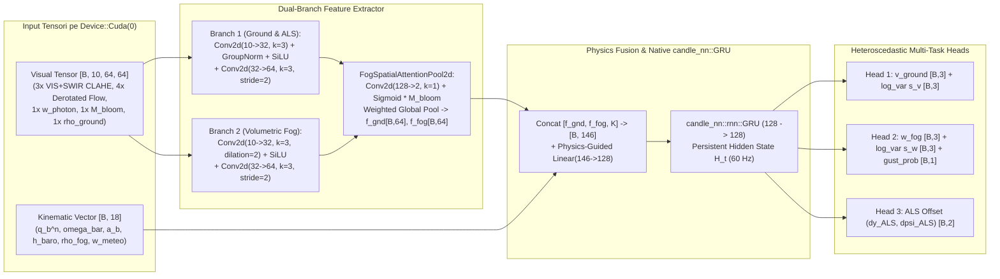

# Specificație Tehnică Crate 2: `aero-ai-cuda`
**Rol**: Mini-Modelul `FogOpticalNavNetV2` în `candle-core` / `candle-nn` (CUDA), Inferență *Lock-Free* `ArcSwap` la $60\text{ Hz}$ și Antrenare în Umbră (`ShadowTrainer`)  
**Cale Crate în Workspace**: `crates/aero-ai-cuda/`  
**Dependențe**: `candle-core = "0.8"`, `candle-nn = "0.8"`, `safetensors = "0.4"`, `arc-swap = "1.7"`, `rand_chacha = "0.3"`

---

## 1. Selecția Automată a Dispozitivului CUDA cu Fallback Transparent pe CPU (`device_manager.rs`)

Pentru a garanta rularea atât pe mașina virtuală **Google Cloud Compute Engine (NVIDIA L4 / T4 GPU)**, cât și pe orice sistem local fără placă dedicată (fără nicio eroare la pornire), crate-ul inițializează dispozitivul prin:

```rust
use candle_core::{Device, DType};

pub struct ComputeBackendInfo {
    pub device: Device,
    pub dtype: DType,
    pub backend_label: String,
    pub is_cuda_accelerated: bool,
}

pub fn init_compute_backend() -> ComputeBackendInfo {
    match Device::cuda_if_available(0) {
        Ok(dev @ Device::Cuda(_)) => ComputeBackendInfo {
            device: dev,
            dtype: DType::F32, // Cu suport FP16/BF16 în kernel-urile matriciale pe L4/T4
            backend_label: "NVIDIA CUDA GPU (Candle Native Kernel)".to_string(),
            is_cuda_accelerated: true,
        },
        _ => ComputeBackendInfo {
            device: Device::Cpu,
            dtype: DType::F32,
            backend_label: "CPU Multi-Core SIMD (Auto-Fallback)".to_string(),
            is_cuda_accelerated: false,
        },
    }
}
```

---

## 2. Arhitectura Neurală `FogOpticalNavNetV2` în `candle-nn` (`model_v2.rs`)

Pentru a evita erorile de compilare cauzate de straturi inexistente (precum un `ConvGRU2d` predefinit), arhitectura este construită **100% din primitive oficiale `candle_nn` (`Conv2d`, `GroupNorm`, `Linear`, `GRU`)** îmbinate cu un strat fizic explicit de **Attention-Weighted Spatial Pooling & Inverse-Depth Decoupling**:



### Semnătura Structurii și Predicției în Rust:
```rust
#[derive(Debug, Clone)]
pub struct NavPredictionOutput {
    pub v_ground_ned: [f64; 3],      // Viteza estimată față de sol [vx, vy, vz] (m/s)
    pub sigma2_v_ground: [f64; 3],   // Incertitudinea heteroscedastică exp(s_v) pentru matricea R_AI din EKF
    pub w_fog_ned: [f64; 3],         // Viteza estimată a masei de ceață/vânt [wx, wy, wz] (m/s)
    pub sigma2_w_fog: [f64; 3],      // Incertitudinea heteroscedastică exp(s_w)
    pub gust_lookahead_score: f64,   // Probabilitatea [0, 1] a unei rafale la 35-80m în fața avionului
    pub als_lateral_offset_m: f64,   // Eroarea laterală față de axul luminos ALS RWY 09
    pub als_heading_error_rad: f64,  // Eroarea unghiulară față de axul pistei RWY 09
}
```

---

## 3. Arhitectura *Double-Buffered Shadow Trainer* (Remedierea Critică #1)

Dacă bucla de $60\text{ Hz}$ ar partaja același `candle_nn::VarMap` cu firul de antrenare în timpul demonstrației `LIVE CUDA FINE-TUNING`, mutex-ul intern din `VarMap` și backward pass-ul ar bloca inferența și ar corupe greutățile la jumătatea cadrului.

Soluția implementată în `crates/aero-ai-cuda/src/shadow_trainer.rs`:
1. **Modelul Activ de Inferență (`Arc<ArcSwap<FrozenFogNavNetV2>>`)**:
   * Conține exclusiv tensori detașați (`.detach()`), fără graf de gradient.
   * Bucla de $60\text{ Hz}$ execută `let model = shared_engine.active_model.load();` în **$< 5\text{ ns}$ (wait-free)** și calculează `model.infer_step(&visual_tensor, &kinematic_tensor, &mut gru_state)` în **$< 1.8\text{ ms}$**.
2. **Antrenorul din Umbră (`ShadowTrainer` pe Thread OS Separat)**:
   * Când juriul apasă butonul **`[⚡ LIVE CUDA FINE-TUNING (15s)]`** (sau la inițializarea rapidă), se lansează thread-ul `aero-cuda-shadow-trainer`.
   * Creează un `VarMap` nou, generează loturi sintetice vectorizate pe GPU (`CudaSyntheticFlightBatcher`, `batch_size = 16`) cu manevre 6-DoF, ceață densă și rafale Von Kármán.
   * La fiecare pas de `candle_nn::AdamW::backward_step(&loss)`, inserează un `std::thread::sleep(Duration::from_millis(2))` pentru a lăsa GPU-ul complet liber pentru cadrul de $60\text{ Hz}$.
   * La finalul fiecărei epoci, exportă tensorii detașați într-o nouă instanță `FrozenFogNavNetV2`, salvează atomic `models/fog_optical_nav_v2_lrcv.safetensors` și apelează:
     ```rust
     shared_engine.active_model.store(Arc::new(new_frozen_model));
     ```

---

## 4. Funcția de Pierdere Fizic-Informată (*Heteroscedastic Gaussian NLL + Inverse-Depth PINN Loss*)

Antrenarea pe GPU optimizează simultan acuratețea vitezei, calibrarea incertitudinii și respectarea ecuației fizice a fluxului optic în inversa adâncimii:

$$\mathcal{L}_{total} = \underbrace{\frac{1}{2}\sum_{k=1}^3 \left( e^{-s_{v,k}}(v_k - \hat{v}_k)^2 + s_{v,k} \right)}_{\text{Heteroscedastic Ground Velocity NLL}} + \underbrace{\frac{1}{2}\sum_{k=1}^3 \left( e^{-s_{w,k}}(w_{fog,k} - \hat{w}_{fog,k})^2 + s_{w,k} \right)}_{\text{Heteroscedastic Fog Wind NLL}} + \lambda_{PINN} \underbrace{\left\| \dot{\mathbf{u}}_{trans} - \hat{\dot{\mathbf{u}}}(\hat{\mathbf{v}}_b, \hat{\mathbf{w}}_{fog}, \rho_{ground}, \hat{\rho}_{fog}) \right\|_2^2}_{\text{Physics-Informed Inverse-Depth Consistency}} + \lambda_{gust}\,\text{BCE}(\hat{p}_{gust}, y_{gust}^*)$$

În timpul antrenării live, metricile fiecărei epoci (`epoch`, `total_loss`, `vel_rmse_mps`, `fog_rmse_mps`, `pinn_residual`, `gpu_time_ms`) sunt transmise live prin WebSocket către graficul din interfața Cockpit HUD!
