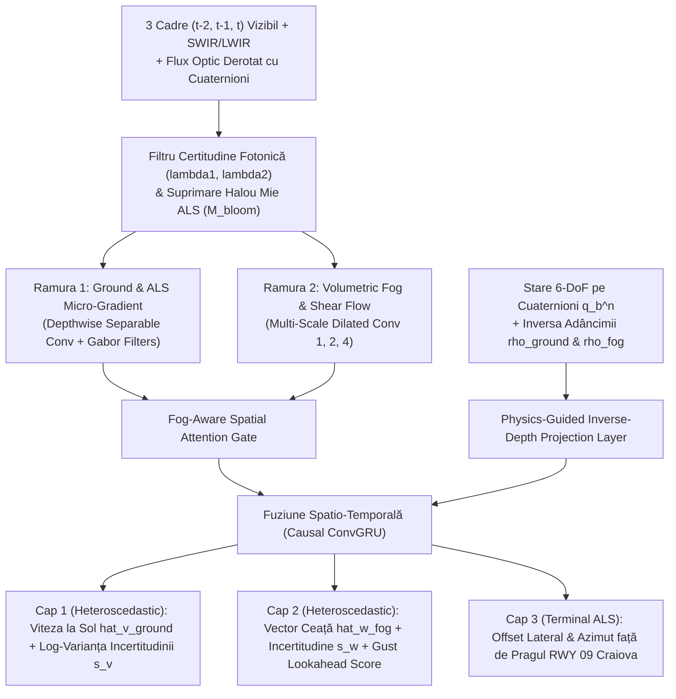

# Arhitectura Mini-Modelului AI V2.0 pe GPU (Rust + CUDA) & Fuziunea Cyber-Meteo `LRCV`
**Sub-modul**: Rețeaua `FogOpticalNavNet V2` (100% Rust `candle-core` CUDA + `safetensors`, compilată și antrenată pe VM-ul cu GPU) + Open-Meteo / METAR `LRCV` + Dual-Layer Anti-Spoofing  
**Proiect**: **AERO-SHIELD LRCV V2.0 (`FogVision 6-DoF — Bulletproof Edition`)**

---

## 1. Arhitectura Mini-Modelului Vizual `FogOpticalNavNet V2` (Rust + CUDA pe Google Cloud GPU VM)

Mini-modelul V2.0 este scris 100% în **Rust (`candle-core` + `candle-nn` cu `features = ["cuda"]`)**, fiind **compilat (`cargo build --release --features cuda`) și antrenat direct pe Mașina Virtuală cu GPU din Google Cloud** (NVIDIA L4 24 GB VRAM / T4 16 GB VRAM). Astfel, laptopul local nu este încărcat nici cu compilarea Rust/CUDA, nici cu antrenarea rețelei neurale. Modelul rulează inferența în $<1.8\text{ ms}$ ($>60\text{ FPS}$) și include **estimarea incertitudinii heteroscedastice**, **fuziune Dual-Band Vizibil + SWIR/LWIR** și **suprimarea haloului luminilor de pistă ALS**.

### 1.1. Intrările Sincronizate Multi-Modale ($60\text{ Hz}$)
1. **Tensorul Vizual & Spectral ($\mathbb{R}^{B \times 12 \times 128 \times 128}$)**:
   * **Canalele 1–3**: Secvența de 3 cadre consecutive $(I_{t-2}, I_{t-1}, I_t)$ pre-procesate prin **CLAHE** + **harta de transmisie Koschmieder**.
   * **Canalele 4–5**: Banda **SWIR / LWIR ($0.9\text{–}14\,\mu\text{m}$)** (unde atenuarea Mie pe picăturile de ceață este de $3\times\text{–}8\times$ mai redusă decât în vizibil) + **Masca Inelară de Suprimare a Haloului ALS (`Glow Suppression Mask`)**.
   * **Canalele 6–9**: Câmpul de flux optic multi-scală derotat pe cuaternioni $\dot{\mathbf{u}}_{trans}(x_c, y_c) = \dot{\mathbf{u}} - \mathbf{B}_{rot}\bar{\boldsymbol{\omega}}_k$ (la scara $1\times$ și $0.5\times$).
   * **Canalul 10**: **Harta Ponderii de Certitudine Fotonică** $w_{photon}(x_c, y_c) \in [0, 1]$ calculată din valorile proprii $(\lambda_1, \lambda_2)$ ale tensorului de structură pe 3 cadre (blochează zgomotul termic în `Flat Whiteout`).
   * **Canalele 11–12**: Coordonatele normalizate ale camerei **CoordConv** $(x_c, y_c)$ + harta **Inverse-Depth a solului** $\rho_{ground}(x_c, y_c) \ge 0$.
2. **Tensorul Cinematic 6-DoF & Meteo ($\mathbb{R}^{B \times 18}$)**:
   * Cuaternionul unitar $\mathbf{q}_b^n = (q_w, q_x, q_y, q_z)$ și unghiurile $(\sin\phi, \cos\phi, \sin\theta, \cos\theta, \sin\psi, \cos\psi)$,
   * Vitezele unghiulare pre-integrate $\bar{\boldsymbol{\omega}}_k = (\bar{p}, \bar{q}, \bar{r})$, accelerațiile $\mathbf{a}_b = (a_x, a_y, a_z)$, altitudinea barometrică $h_{baro}$,
   * Scara adâncimii ceții $\hat{\rho}_{fog}$ și priorul meteo validat $\bar{\mathbf{w}}_{meteo}(z)$.

### 1.2. Diagrama Arhitecturală `FogOpticalNavNet V2`

### 1.3. Antrenare pe GPU cu *Heteroscedastic Gaussian NLL Loss* & *Severe Domain Randomization*
* **Funcția de Cost Fizic-Informată cu Incertitudine Aleatorică ($\mathcal{L}_{V2}$)**:
  Rețeaua nu prezice doar $(\hat{\mathbf{v}}_{ground}, \hat{\mathbf{w}}_{fog})$, ci și log-varianța incertitudinii proprii $(\mathbf{s}_v, \mathbf{s}_w)$, unde $\hat{\sigma}_v^2 = \exp(\mathbf{s}_v)$:
  $$\mathcal{L}_{V2} = \frac{1}{2}\sum_{k \in \{x,y,z\}} \left( e^{-s_{v,k}}\|\hat{v}_{ground,k} - v_{ground,k}^*\|^2 + s_{v,k} \right) + \frac{1}{2}\sum_{k \in \{x,y,z\}} \left( e^{-s_{w,k}}\|\hat{w}_{fog,k} - w_{fog,k}^*\|^2 + s_{w,k} \right) + \lambda_{PINN}\mathcal{L}_{\text{inv\_depth}} + \lambda_{gust}\mathcal{L}_{BCE}$$
  Covarianța prezisă $\mathbf{R}_{AI}(t) = \text{diag}(\exp(\mathbf{s}_v(t)))$ intră direct în filtrul Kalman ES-EKF!
* **Severe Domain Randomization în VRAM pe GPU**:
  Loturile de antrenare includ zgomot Poisson-Gaussian, picături de ploaie pe parbriz, motion blur la rotații rapide, halouri nesimetrice ALS și câmpuri turbulente 3D **Von Kármán / Dryden**.
* **Pornire Instantanee (`<0.4s`) + Antrenare și Compilare pe VM-ul cu GPU**:
  Întregul proiect Rust se compilează pe VM-ul cu GPU din Google Cloud, iar la pornire se încarcă automat checkpoint-ul pre-antrenat `fog_optical_nav_v2_lrcv.safetensors`. Interfața oferă butonul **`[RUN LIVE CUDA FINE-TUNING (15s)]`** (executat prin `ShadowTrainer` + `ArcSwap` direct pe GPU-ul din VM) pentru demonstrarea antrenării live în fața mentorilor.

---

## 2. Integrarea Datelor Deschise Meteo (`LRCV` Craiova) & Protecția Contra *Data Poisoning*

### 2.1. Preluare Asincronă Non-Blocking (`timeout = 1.5s`)
Când internetul este activ, modulul interoghează asincron coordonatele pragului pistei **RWY 09 Craiova (`44.3181° N, 23.8886° E`)**:
* **Open-Meteo Aviation API**: viteza și direcția vântului la `10m`, `80m`, `120m`, `180m`, rafalele (`wind_gusts_10m`), vizibilitatea (`visibility`), plafonul de nori joși (`cloud_cover_low`), temperatura și punctul de rouă (`temperature_2m`, `dew_point_2m`).
* **Parser `METAR LRCV`**: extrage RVR pe pista 09, vizibilitatea $V_{MOR}$ (folosită în ancora Koschmieder $\hat{\rho}_{fog, opt} \approx 3.0 / V_{MOR}$) și fenomenele `FG` / `BR`.

### 2.2. `Optical-Aerodynamic Meteo Sanity Gate` (Protecție Contra *Pre-Cut Meteo Cache Poisoning*)
Dacă un atacator falsifică datele meteo în rețea *înainte* de a tăia internetul (`CUT INTERNET`), sistemul detectează anomalia prin verificarea încrucișată cu două mărimi fizice interne:
1. Viteza optică a ceții $\hat{\mathbf{w}}_{fog, opt}$ extrasă din cameră + IMU,
2. Viteza vântului din triunghiul aerodinamic $\hat{\mathbf{w}}_{aero} = \hat{\mathbf{v}}_{ground} - \mathbf{R}_b^n(\mathbf{q})\mathbf{v}_{TAS,b}$.

Dacă $\|\bar{\mathbf{w}}_{cache}(z) - \hat{\mathbf{w}}_{fog, opt}\|_2 > 4.5\text{ m/s}$, sistemul declanșează alerta **`POISONED OR OUTDATED METEO CACHE REJECTED`**, anulează ponderea cache-ului corupt și folosește 100% estimarea optică-aerodinamică live!

---

## 3. Apărare Multi-Strat Anti-Spoofing GPS (`Dual-Layer Federated GNSS Watchdog`)

Estimarea optică-inerțială 6-DoF rulează într-un **filtru federat izolat** (nu este niciodată contaminată de coordonatele GPS). Detectorul de spoofing operează pe două straturi simultane:

1. **Stratul 1 — Instantaneous Mahalanobis $\chi^2$ Gate ($<100\text{ ms}$, contra *Jump Spoofing*)**:
   $$\gamma_{inst}(t_k) = \mathbf{r}_k^T \mathbf{S}_k^{-1} \mathbf{r}_k > \chi^2_{6, 0.999} = 22.46, \qquad \mathbf{r}_k = \begin{bmatrix} \mathbf{p}_{GPS,k} - \hat{\mathbf{p}}_{opt,k} \\ \mathbf{v}_{GPS,k} - \hat{\mathbf{v}}_{opt,k} \end{bmatrix}$$
2. **Stratul 2 — Sliding-Window Vector CUSUM / GLRT (Contra *Stealth Slow-Ramp Spoofing*)**:
   Pentru a prinde atacatorii sofisticați care trag încet poziția GPS cu doar $0.15\text{–}0.3\text{ m/s}$ lateral (sub pragul unui singur cadru), sistemul acumulează reziduul direcțional pe o fereastră glisantă de $5\text{ secunde}$:
   $$\mathbf{S}_{CUSUM}(t_k) = \max\left(\mathbf{0},\; \mathbf{S}_{CUSUM}(t_{k-1}) + \mathbf{S}_k^{-1/2}\mathbf{r}_k - \kappa_{drift}\right) > \tau_{CUSUM}$$
   Prinde garantat orice atac *Stealth Slow-Ramp* în **$<3.2\text{ secunde}$** (înainte ca eroarea să depășească $0.5\text{ m}$), comutând aeronava în modul **`FULL FORTRESS AUTONOMY`**.

---

## 4. Pâlnia de Apropiere în 3 Faze pe Pista RWY 09 Craiova (`Coarse-to-Fine Approach Funnel`)

| Faza de Apropiere | Distanță până la Pragul RWY 09 | Altitudine $h_{AGL}$ | Regimul Dominant de Navigație `AERO-SHIELD V2.0` | Eroare Laterală Maximă |
| :--- | :---: | :---: | :--- | :---: |
| **Faza 1: Outer Approach** | $10.0\text{ km} \to 1.5\text{ km}$ | $500\text{ m} \to 80\text{ m}$ | Odometrie 6-DoF pe micro-contrastul sub-orizont + decuplare vânt/ceață pe straturi (`120m -> 80m`) + altimetrie barometrică $h_{baro}$. | $< 15.0\text{ m}$ (în conul de captură ALS) |
| **Faza 2: Middle Capture** | $1.5\text{ km} \to 300\text{ m}$ | $80\text{ m} \to 18\text{ m}$ | Detecția în banda **SWIR/LWIR** a balizajului luminos **ALS RWY 09** ($900\text{ m}$ lungime) cu suprimarea haloului Mie + corecție de azimut. | $< 1.5\text{ m}$ |
| **Faza 3: Terminal Touchdown** | $300\text{ m} \to 0\text{ m}$ | $18\text{ m} \to 0\text{ m}$ | Fixare pe bara verde de prag (**Threshold RWY 09**) și marcajele transversale „Zebra" + redresare (*flare*) cu unghi de corecție $\psi_{crab}$. | **$< 0.8\text{ m}$ la atingerea pistei** |
